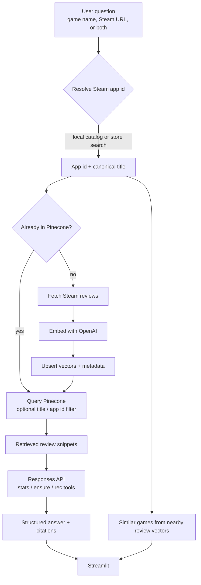

# Game Review Assistant

Ask questions about games — by name or Steam URL — and get answers grounded in real Steam reviews. Games that are not in the index yet are resolved from Steam's app list and ingested on first ask.

The pipeline: Steam ingest → OpenAI embeddings → Pinecone → the OpenAI Responses API (tools, structured JSON, streaming) → Streamlit.

## How it works



Seed games are ingested up front (`ingest_steam` → `embed`). Anything else is resolved and indexed on first ask. Pinecone is the source of truth; local JSON is a cache.

## Setup
```bash
python -m venv .venv
.venv\Scripts\activate          # macOS/Linux: source .venv/bin/activate
pip install -r requirements.txt
copy .env.example .env          # then paste OPENAI_API_KEY and PINECONE_API_KEY
```

Create a serverless Pinecone index (the app can also create `game-review-assistant` on first run: 1536 dims, cosine, AWS `us-east-1`).

## Run
```bash
python -m src.ingest_steam      # optional: seed data/games_meta.json + data/reviews.jsonl
python -m src.embed             # upsert seed reviews into Pinecone
streamlit run app.py
```

Unknown titles are resolved with the local catalog plus Steam store search. Games that were never in the original ~20-title seed are ingested on first ask.

## Layout
```
app.py                 Streamlit UI
src/config.py          env, paths, models
src/ingest_steam.py    Steam metadata + reviews
src/steam_resolve.py   URL / name → app id
src/embed.py           embeddings → Pinecone
src/retrieve.py        search, on-demand index, recs
src/tools.py           stats / ensure / recommend
src/respond.py         Responses API
```

## Deploy (Streamlit Community Cloud)
Secrets:
```toml
OPENAI_API_KEY = "sk-..."
PINECONE_API_KEY = "pcn-..."
```

On-demand ingest on Cloud writes local JSON that can disappear on restart; **Pinecone is the source of truth** for reviews and stats.
